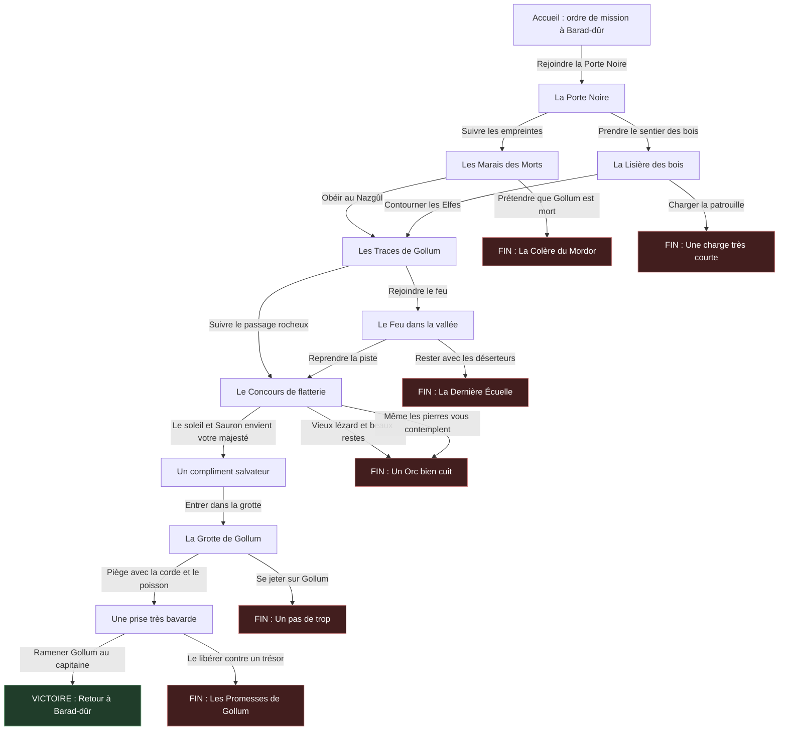

# Projet-choix-multiple

## Arborescence de La Traque de Gollum

Les flèches représentent les choix du joueur. Les fins rouges sont des échecs ; la fin verte est la victoire. Chaque fin permet de recommencer à l’accueil (ces liens sont omis pour garder le schéma lisible).

17 pages : 10 scènes de départ ou de progression, 6 fins d’échec et 1 fin de victoire.

